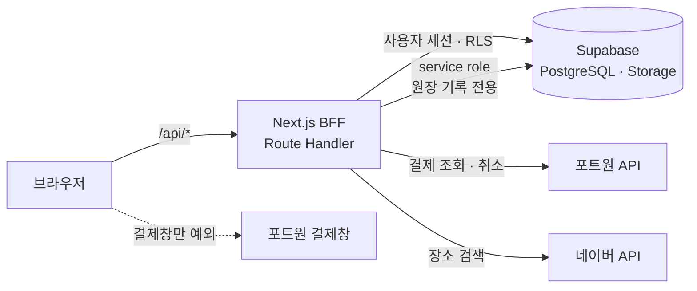
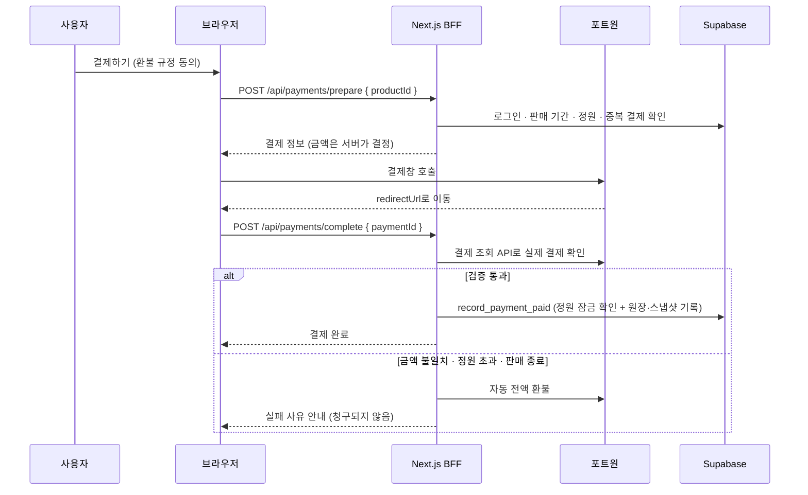

# 구로 맛길 (GURO MATGIL)

> 구로 주변 이웃이 직접 다녀온 **숨은 맛집**을 공유하고, 맛집 **강연·모임에 결제하고 참여**하는 커뮤니티 웹 서비스

**🔗 서비스 주소: [dev-henessy.kro.kr](https://dev-henessy.kro.kr/)**
(구글 로그인 후 이용할 수 있습니다)

<!-- 대표 화면 캡처나 GIF를 여기에 넣어주세요 -->
<!--  -->

---

## 왜 만들었나

주말마다 "어디 가서 뭐 먹지?"를 고민하지만, 지도 앱과 블로그 검색 결과는 **광고·체험단 글**이 많고 늘 가던 **유명한 곳만 반복**해서 나옵니다.

구로 맛길은 **서울 구로 주변에 사는, 차가 있는 가족과 커플**을 위해 실제 이웃이 다녀온 맛집 정보를 한곳에 모읍니다. 여기에 맛집을 좋아하는 사람들이 **직접 만나는 강연·모임을 유료 상품**으로 열어, 온라인 커뮤니티를 오프라인 경험과 첫 수익 구조로 이어가는 것을 목표로 합니다.

---

## 주요 기능

### 맛집 커뮤니티
| 기능 | 설명 |
|---|---|
| 구글 로그인 | Supabase Auth 기반 OAuth, 쿠키 세션 유지 |
| 맛집 등록 | 사진 · 이름 · 설명 · 주소 입력, 네이버 장소 검색으로 정확한 위치 선택 |
| 맛집 목록 · 검색 | 최신순 카드 목록, 이름 · 내용 · 주소 키워드 검색 |
| 맛집 상세 | 사진 슬라이드, 네이버 지도 핀 표시, 주소 복사, 외부 지도 길찾기 연결 |
| 수정 · 삭제 | 본인이 쓴 글만 가능 |
| 마이 페이지 | 닉네임 · 프로필 사진 변경, 내가 쓴 글 / 결제 내역 / 취소 내역 탭 |

### 강연 · 모임 결제
| 기능 | 설명 |
|---|---|
| 메인 배너 | 판매 중인 상품을 배너로 노출, 참여 인원 / 정원 표시, 마감 상품은 뒤로 |
| 상품 상세 | 일시 · 장소 · 가격 · 환불 규정, 상황별 버튼 상태(결제하기 / 모집 마감 / 판매 종료 / 참여 예정) |
| 결제 | 포트원 V2 결제창(카드), 환불 규정 동의 후 결제 |
| 결제 결과 | 새로고침하거나 뒤로 가도 결제가 다시 일어나지 않음 |
| 결제 취소 | 행사 3일 전까지 전액 환불, 이후에는 사유와 함께 버튼 비활성화 |

### PWA
- 홈 화면에 설치해 앱처럼 사용 (스플래시 · 아이콘)
- 카카오톡 인앱 브라우저 · 삼성 인터넷에서도 설치 안내 배너 노출

---

## 기술 스택

| 영역 | 기술 |
|---|---|
| 프레임워크 | Next.js 16 (App Router) · React 19 · TypeScript |
| 스타일 | Tailwind CSS v4 · 디자인 토큰 |
| 백엔드 | Next.js Route Handler (BFF) |
| DB · 인증 · 저장소 | Supabase (PostgreSQL · Auth · Storage · RLS) |
| 결제 | 포트원 V2 (`@portone/browser-sdk` · `@portone/server-sdk`) |
| 지도 · 장소 | 네이버 지도 API · 네이버 지역 검색 API |
| UI 개발 · 테스트 | Storybook 10 · Vitest · Playwright |
| 배포 | Vercel · PWA |

---

## 아키텍처

브라우저는 Supabase나 포트원 API를 **직접 호출하지 않습니다.** 모든 요청은 Next.js 서버(BFF)를 거칩니다.



---

## 설계에서 신경 쓴 점

### 1. 키는 서버에만 둔다 — BFF 패턴
- Supabase · 포트원 키는 `NEXT_PUBLIC_` 접두사 없이 **서버 환경변수로만** 관리합니다.
- 서버 전용 모듈은 `import "server-only"`로 시작해, 실수로 브라우저 번들에 섞여 들어가는 것을 빌드 단계에서 막습니다.
- 원장 기록용 service role 키는 정해진 DB 함수 호출에만 사용합니다.

### 2. 결제 금액은 서버가 정한다
브라우저가 보낸 금액이나 상품명은 **어디에도 사용하지 않습니다.**
- 결제 준비 단계에서 서버가 DB의 상품 가격으로 결제 정보를 만들어 내려줍니다.
- 결제 완료 후에는 브라우저의 "성공" 신호를 믿지 않고, **포트원 결제 조회 API로 실제 결제를 다시 확인**합니다.
- 결제 금액이 현재 상품 가격과 다르면 위변조로 보고 **즉시 자동 환불**합니다.

### 3. 결제 기록은 지우거나 고치지 않는다 — append-only 원장
- 결제 원장(`payment`)은 **INSERT만 허용**합니다. UPDATE · DELETE는 DB 트리거가 service role까지 포함해 모두 막습니다.
- 상태가 바뀌면 행을 고치는 대신 새 행을 추가합니다. (`PAID` → `CANCEL_REQUESTED` → `CANCELLED`)
- 원장 행마다 그 시점의 결제 응답과 상품 정보를 **스냅샷**으로 함께 저장합니다. 상품이 나중에 바뀌어도 결제 내역에는 구매 당시 내용이 보입니다.

### 4. 같은 요청이 여러 번 와도 결과는 하나 — 멱등성
- `unique (transaction_key, type)` 제약으로 같은 결제의 같은 이벤트는 한 번만 기록됩니다.
- 결제 완료 페이지를 새로고침해도 중복 결제 · 중복 기록이 생기지 않습니다.

### 5. 동시에 결제해도 정원을 넘기지 않는다
- 정원 확인과 결제 기록을 하나의 DB 함수 안에서 처리하며, 상품 행을 `FOR UPDATE`로 잠가 동시 결제에도 초과 판매가 일어나지 않게 했습니다.
- 정원이 이미 찼다면 결제는 자동 환불되고 "방금 마감되었어요"를 안내합니다.

### 6. 규칙을 문서로 먼저 정하고, 코드를 맞춘다
- 결제 · 취소 · 환불 규칙은 [`.claude/rules/payment.md`](.claude/rules/payment.md)에 먼저 정의하고 코드는 이 문서를 따릅니다. 규칙을 바꿀 때는 문서를 먼저 고칩니다.
- 권한(RLS) · 원장 구조 · 실패 시 처리 방식까지 문서에 표로 정리해 두었습니다.

---

## 결제 흐름



---

## 디자인 시스템과 Storybook

- 색상 · 타이포그래피 · 아이콘 · 간격을 **디자인 토큰**으로 정의하고, 코드에서는 hex 값 대신 시맨틱 토큰(`text-text-*`, `bg-background-*`)만 사용합니다.
- 버튼 · 입력창 · 바텀시트 · 모달 등 UI 컴포넌트를 **Storybook 스토리 41개**로 정리해, 디자인과 개발이 같은 기준을 보도록 했습니다.
- 새 화면은 스토리에 있는 컴포넌트를 먼저 재사용합니다.

---

## 개발 과정

| 날짜 | 단계 |
|---|---|
| 10/16 | PRD v0.1 작성 — 로그인 · 마이 페이지 · 맛집 목록 / 등록 / 상세 |
| 10/16 ~ 10/23 | 디자인 시스템 — 색상 · 타이포 · 아이콘 · UI 컴포넌트 |
| 10/26 | Storybook 핸드오프 · 반응형 가이드 |
| 10/27 ~ 10/29 | 구글 소셜 로그인 · 네이버 장소 검색 · 네이버 지도 |
| 10/30 | 배포 · 로그인 접근 제어 · PWA |
| 11/02 | PRD v0.2 — 강연 · 모임 결제 기능 추가 |
| 11/04 ~ 11/09 | 결제 디자인 · 핸드오프 · 포트원 V2 결제 연동 |

자세한 요구사항은 [`02-prd.md`](02-prd.md)에 정리되어 있습니다.

---

## 프로젝트 구조

```
src/
├─ app/
│  ├─ api/            # BFF Route Handler
│  │  ├─ auth/        # 구글 로그인 · 콜백 · 로그아웃
│  │  ├─ places/      # 맛집 CRUD · 장소 검색 · 지도
│  │  ├─ products/    # 강연 · 모임 상품
│  │  ├─ payments/    # 결제 준비 · 완료 검증 · 취소
│  │  └─ profile/
│  ├─ restaurants/    # 맛집 상세 · 등록 · 수정
│  ├─ products/       # 상품 상세 · 결제 완료
│  ├─ orders/         # 결제 결과
│  └─ mypage/
├─ components/
│  ├─ foundations/    # Text, Icon
│  ├─ ui/             # 공통 UI 컴포넌트
│  └─ screens/        # 화면 단위 컴포넌트
├─ lib/
│  ├─ supabase/       # 서버 전용 Supabase 클라이언트
│  ├─ shop.ts         # 상품 · 결제 도메인 로직
│  └─ portone.ts      # 포트원 서버 SDK 래퍼
├─ stories/           # Storybook
└─ styles/            # 디자인 토큰
```

---

## 로컬에서 실행하기

```bash
# 1. 의존성 설치
npm install

# 2. 환경변수 설정 — .env.example을 복사해 값을 채웁니다
cp .env.example .env.local

# 3. 개발 서버
npm run dev          # http://localhost:3000

# Storybook
npm run storybook    # http://localhost:6006
```

필요한 환경변수 목록과 설명은 [`.env.example`](.env.example)에 있습니다. 모든 키는 서버 전용입니다.

---

## 앞으로 할 일

- [ ] 포트원 웹훅 연동 — 환불 처리 중 상태 자동 반영 (규칙은 결제 문서 10절에 정의됨)
- [ ] 결제 검증 로직 단위 테스트
- [ ] DB 스키마 · RLS · 원장 트리거를 마이그레이션 파일로 저장소에 포함
- [ ] 맛집 목록 무한 스크롤
- [ ] 부분 취소 지원
